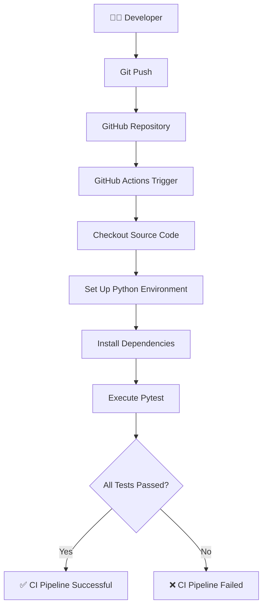

# ⚡ PulseCI — Automated CI Pipeline

### Every push. Automatically tested. Always reliable.

<p align="center">
  
  
  
  
  
</p>

<p align="center">
  <b>A beginner-friendly DevOps project demonstrating Continuous Integration through GitHub Actions and automated Python testing.</b>
</p>

---

## 📌 Table of Contents

- [Overview](#-overview)
- [The Problem](#-the-problem)
- [The Solution](#-the-solution)
- [System Architecture](#-system-architecture)
- [How It Works](#-how-it-works)
- [Project Structure](#-project-structure)
- [Technology Stack](#-technology-stack)
- [Application Functionality](#-application-functionality)
- [Test Cases](#-test-cases)
- [Getting Started](#-getting-started)
- [Running the CI Pipeline](#-running-the-ci-pipeline)
- [Results](#-results)
- [Future Improvements](#-future-improvements)
- [Learning Outcomes](#-learning-outcomes)

---

## 🚀 Overview

**PulseCI** is a Python-based Continuous Integration project that automates application testing using GitHub Actions.

The project combines a simple E-Commerce Pricing Engine with an automated CI workflow. Whenever code is pushed to the GitHub repository, the workflow automatically prepares the Python environment, installs dependencies, and executes the test suite using Pytest.

The goal is simple: reduce repetitive manual testing and catch errors earlier in the development process.

## ❗ The Problem

During application development, even a small code change can introduce unexpected bugs.

Running tests manually after every modification can become repetitive, time-consuming, and easy to forget.

This creates a simple but important question:

**Why should developers manually verify every code change when the testing process can be automated?**

## 💡 The Solution

I built PulseCI to demonstrate how Continuous Integration can solve this problem.

Instead of manually executing the test suite after every update, GitHub Actions automatically runs the tests whenever code is pushed to the repository.

If all tests pass, the workflow reports success. If a test fails, the workflow reports failure, making the issue visible.

## 🏗️ System Architecture



## ⚙️ How It Works

PulseCI follows an automated workflow:

1. **Code Push:** A developer pushes code changes to the GitHub repository.
2. **Workflow Trigger:** GitHub Actions detects the push event.
3. **Environment Setup:** A GitHub-hosted runner prepares the Python environment.
4. **Dependency Installation:** Required packages are installed using `requirements.txt`.
5. **Test Execution:** Pytest executes the automated test cases.
6. **Result Reporting:** GitHub Actions reports whether the workflow passed or failed.

No manual test execution is required on the GitHub runner.

## 📂 Project Structure

```text
PulseCI-Automated-CI-Pipeline/
│
├── .github/
│   └── workflows/
│       └── ci.yml
│
├── app.py
├── test_app.py
├── requirements.txt
├── README.md
└── .gitignore
```

### File Responsibilities

| File | Description |
|---|---|
| `app.py` | E-Commerce Pricing Engine |
| `test_app.py` | Automated test cases |
| `requirements.txt` | Python dependencies |
| `.github/workflows/ci.yml` | GitHub Actions CI configuration |
| `.gitignore` | Excludes unnecessary files |

## 🛠️ Technology Stack

| Technology | Purpose |
|---|---|
| Python | Application development |
| Pytest | Automated testing |
| Git | Version control |
| GitHub | Source code hosting |
| GitHub Actions | Continuous Integration |
| pip | Dependency management |
| Python venv | Isolated development environment |

## 🧮 Application Functionality

The project uses an E-Commerce Pricing Engine to demonstrate application logic and automated testing.

It calculates the final price of an order using:

- Unit price
- Product quantity
- Discount percentage
- Tax percentage
- Final calculated amount

### Example Execution

```text
==================================================
 PulseCI E-Commerce Pricing Engine
==================================================
Item Unit Price    : $49.99
Quantity           : 3
Discount Rate      : 10.0%
Tax Rate           : 8.5%
--------------------------------------------------
Final Total Price  : $146.44
==================================================
[SUCCESS] Application executed cleanly.
```

## 🧪 Test Cases

The project includes nine automated test cases covering normal operations and edge cases.

| # | Test Scenario | Expected Behaviour |
|---|---|---|
| 1 | Normal discount calculation | Correct discount |
| 2 | Normal total price calculation | Correct final amount |
| 3 | Zero discount percentage | No discount applied |
| 4 | Full 100% discount | Complete discount applied |
| 5 | Minimum quantity and zero tax | Correct minimum order calculation |
| 6 | Discount exceeding maximum percentage | Invalid discount handled |
| 7 | Negative unit price | Invalid price handled |
| 8 | Zero quantity | Zero-quantity case handled |
| 9 | Non-numeric input validation | Invalid input handled |

## 💻 Getting Started

Follow these steps to run PulseCI locally on Windows.

### 1. Clone the Repository

```powershell
git clone https://github.com/Chethana45/PulseCI-Automated-CI-Pipeline.git
```

### 2. Navigate to the Project

```powershell
cd PulseCI-Automated-CI-Pipeline
```

### 3. Create a Virtual Environment

```powershell
python -m venv .venv
```

### 4. Activate the Environment

```powershell
.venv\Scripts\Activate.ps1
```

If PowerShell blocks script execution, run:

```powershell
Set-ExecutionPolicy -Scope Process -ExecutionPolicy Bypass
```

Then activate the environment again.

### 5. Install Dependencies

```powershell
pip install -r requirements.txt
```

### 6. Run the Application

```powershell
python app.py
```

### 7. Run Automated Tests

```powershell
pytest -v
```

## 🔄 Running the CI Pipeline

The CI workflow is configured in:

```text
.github/workflows/ci.yml
```

To trigger the pipeline:

```powershell
git add .
git commit -m "Update application"
git push origin main
```

Then:

1. Open the GitHub repository.
2. Navigate to the **Actions** tab.
3. Select **PulseCI - Automated CI Pipeline**.
4. Open the latest workflow run.
5. Inspect the execution steps and test results.

GitHub Actions automatically executes the configured workflow after the push event.

## 📊 Results

<details>
<summary><b>Local test execution</b></summary>

```text
===================== test session starts ======================

collected 9 items

test_app.py::test_calculate_discount_normal PASSED
test_app.py::test_calculate_total_price_normal PASSED
test_app.py::test_calculate_discount_zero_percent PASSED
test_app.py::test_calculate_discount_full_hundred_percent PASSED
test_app.py::test_calculate_total_price_minimum_quantity_and_zero_tax PASSED
test_app.py::test_calculate_discount_exceeding_max_percentage PASSED
test_app.py::test_calculate_total_price_negative_unit_price PASSED
test_app.py::test_calculate_total_price_zero_quantity PASSED
test_app.py::test_validate_number_non_numeric_type PASSED

====================== 9 passed in 0.09s ======================
```

</details>

**Verified project outcomes:**

- 9/9 local automated tests passed.
- Application executed successfully.
- GitHub Actions workflow completed successfully.
- Automated testing was triggered by a Git push.

## 🔮 Future Improvements

PulseCI provides a foundation for exploring more advanced DevOps practices.

Potential enhancements:

- 🐳 Docker containerization.
- 📈 Code coverage reports.
- 🔍 Static code analysis and linting.
- 🔐 Security and dependency scanning.
- 🚀 Automated deployment through a CD pipeline.
- 📦 Build artifact generation.

## 🎓 Learning Outcomes

Building PulseCI helped me understand how development workflows can be automated using DevOps practices.

Key concepts explored:

- Understanding Continuous Integration.
- Creating and managing Python virtual environments.
- Installing and managing project dependencies.
- Writing automated tests using Pytest.
- Configuring GitHub Actions workflows.
- Connecting Git pushes with automated test execution.
- Understanding successful and failed CI pipeline runs.

The biggest takeaway was understanding how a simple code push can trigger an entire automated verification process.

---

## 👩‍💻 Author

**Chethana Sri**

Computer Science Engineering Student | Aspiring Software Engineer | Exploring DevOps

- GitHub: [@Chethana45](https://github.com/Chethana45)
- Project Repository: [PulseCI — Automated CI Pipeline](https://github.com/Chethana45/PulseCI-Automated-CI-Pipeline)

---

<p align="center">
  <b>Built to learn. Automated to improve. Tested to trust. ⚡</b>
</p>

<p align="center">
  If you find this project useful, consider giving it a ⭐ on GitHub!
</p>

**License:** This project is licensed under the MIT License.
